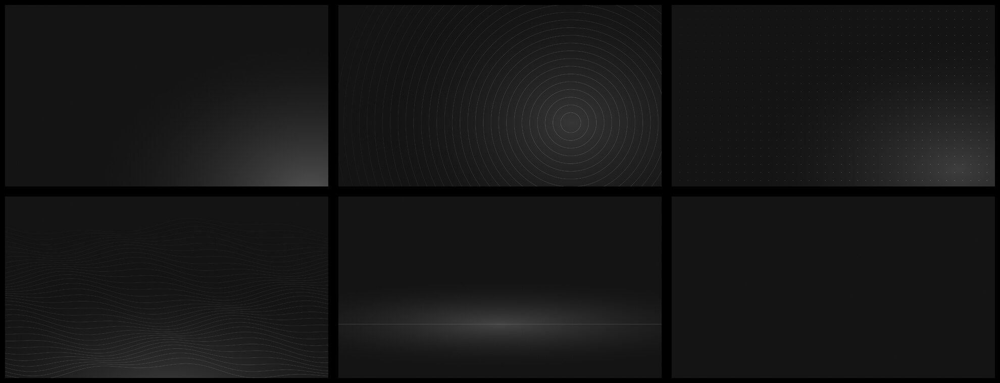

# mono

a grayscale [omarchy](https://omarchy.org) theme that keeps the colors where the code is.

the desktop is graphite and gray: window borders, the bar, menus, notifications, the lock screen, the wallpapers.
the terminal and neovim get a real palette, [carbonfox](https://github.com/EdenEast/nightfox.nvim),
so code, diffs and `ls` still read the way they should.


## install

```sh
omarchy theme install https://github.com/gloomyweather/omarchy-mono-theme
```

then pick it in the omarchy menu (style → theme), or run `omarchy theme set mono`.
`omarchy theme update` pulls new versions later.

## what's inside

- `colors.toml`. omarchy builds the terminal, hyprland, btop, helix and the rest from it.
- `shell.toml`. the bar, menus and lock screen without red: alerts and errors show in white,
  and bar text is a little dimmer so they stand out.
- `neovim.lua` with carbonfox. omarchy skips `.lua` files from installed themes, so after
  `omarchy theme install` neovim gets a scheme generated from the same palette instead.
  it looks close: same background, same colors, slightly different roles.
- six wallpapers, 1920×1080, in `backgrounds/`. switch them in style → background.
- a light gray boot and unlock logo. turn it on in style → unlock.
- yaru-blue icons, omarchy's default. yaru has no gray folders.

## palette

```
background  #161616    foreground  #f2f4f8
accent      #dfdfe0    muted       #7b7c7e
surface     #252525    selection   #2a2a2a
border      #353535    active      #b6b8bb
```

ansi colors come from carbonfox:

```
red      #ee5396  #f16da6    blue     #78a9ff  #8cb6ff
green    #25be6a  #46c880    magenta  #be95ff  #c8a5ff
yellow   #f1c21b  #fddc69    cyan     #33b1ff  #52bdff
```

yellow is a real yellow. carbonfox puts teal in that slot, which makes warnings look odd.

## wallpapers



```
1  light     a soft glow from the corner
2  rings     thin circles around one point
3  grid      small crosses fading out
4  contours  topographic lines
5  horizon   a line and the light above it
6  flat      just graphite and grain
```

`mono-walls.sh` redraws all six from scratch:

```sh
./mono-walls.sh ~/mono-walls
```

it needs imagemagick 7.

## license

mit. the wallpapers are part of it. the unlock logo is omarchy's, recolored.
